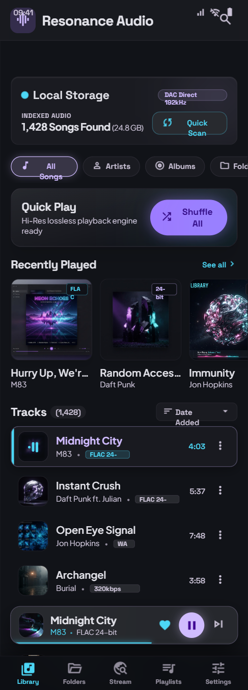
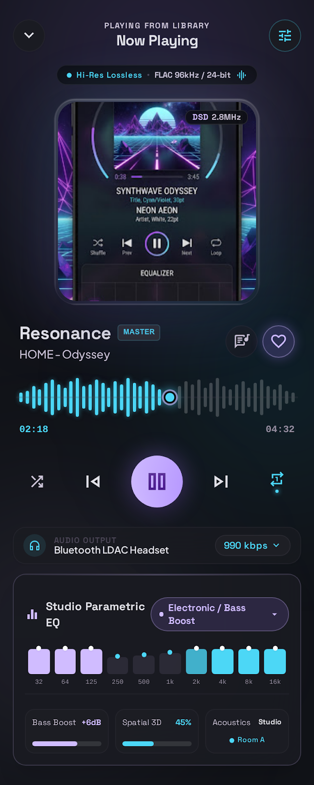
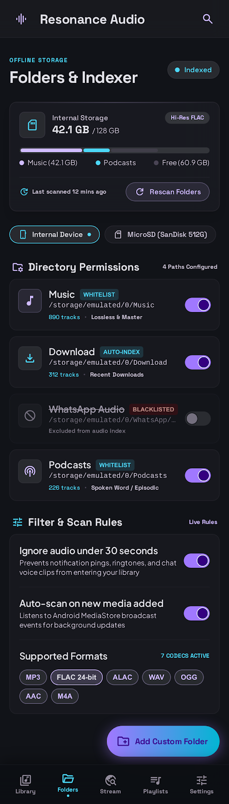
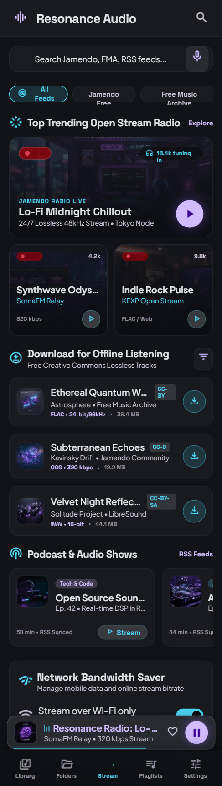

# Resonance Audio

Android music player built with **Kotlin Multiplatform + Compose Multiplatform**, following the
*Kinetic Glass Obsidian* design system.

<p align="center">
  
  
  
  
</p>

## Features

- **Local library** — MediaStore scanning, per-folder indexing and whitelists, search, favourites,
  sorting, and browsing by **Artists / Albums / Genres / Folders** with group detail views.
- **Now Playing** — live waveform, transport controls, repeat/shuffle, real device equalizer
  (60 / 230 / 910 / 4k / 14k Hz bands) with presets, bass boost and spatialiser.
- **Stream discovery** — curated open radio (SomaFM, KEXP), Creative Commons download shelf and
  podcasts, with offline downloads through DownloadManager.
- **Playlists** — create, rename, delete, add tracks, play from playlist.
- **Settings** — scan rules, storage analytics, output and playback preferences.
- **Motion** — directional slide + fade transitions between tabs, animated mini player.

## Stack

| Piece | Version |
| --- | --- |
| Kotlin | 2.1.0 |
| Compose Multiplatform | 1.7.3 |
| Android Gradle Plugin | 8.7.3 |
| Media3 (ExoPlayer / Session) | 1.5.1 |
| Coroutines | 1.9.0 |

`minSdk 26`, `compileSdk`/`targetSdk 36`.

## Structure

```
composeApp/src/commonMain/kotlin/com/resonance/audio/
├── app/        AppStore — single source of truth
├── core/       pure logic: format, wavegen, EQ presets, queue rules, grouping
├── core/model/ shared data models
├── data/       stream catalog
└── ui/         theme, components, screens
composeApp/src/androidMain/kotlin/com/resonance/audio/
├── data/       MediaStore library + SharedPreferences settings store
├── playback/   ExoPlayer engine + MediaSession service
└── MainActivity.kt
```

## Build

```bash
./gradlew :composeApp:assembleDebug        # debug APK
./gradlew :composeApp:testDebugUnitTest     # unit tests
```

Output: `composeApp/build/outputs/apk/debug/composeApp-debug.apk`

## Tests

26 unit tests covering formatting helpers, waveform generation, EQ preset stability, queue logic
and library grouping.
